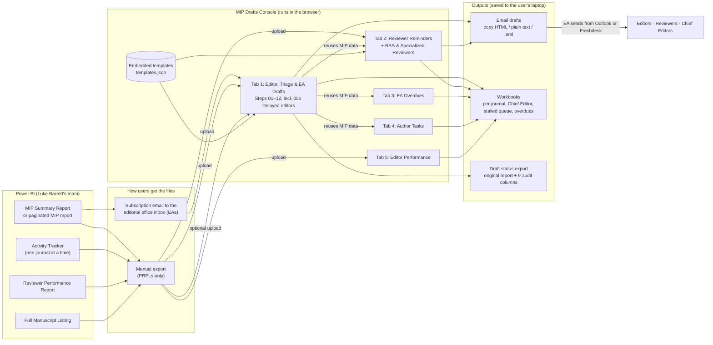
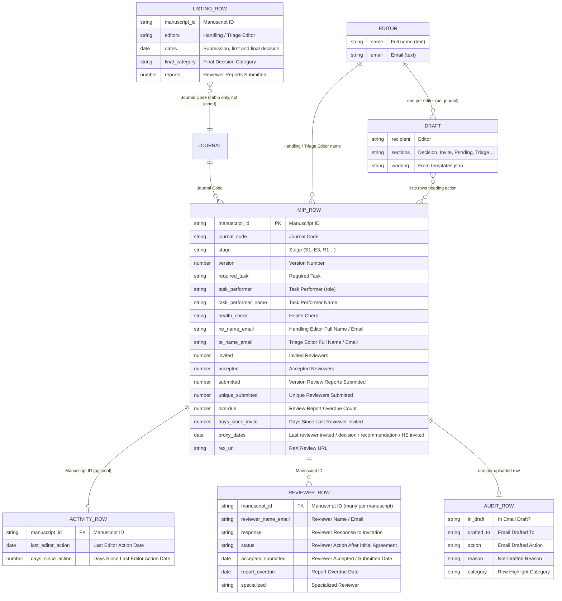
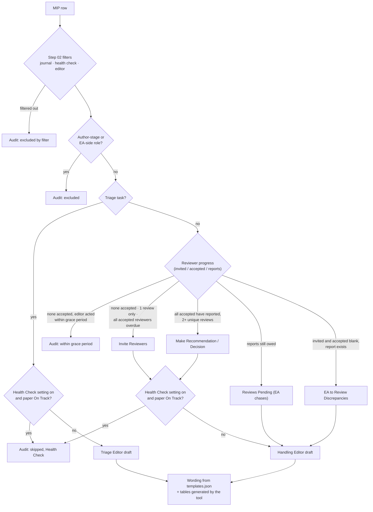

# Data model: how Power BI data powers the MIP Drafts Console

**Version:** console v2.2 · **Last updated:** 1 Oct 2026 · **Written from:** the code in `mip-drafts-console.html`, not from screenshots or memory

The console has no database and no live connection. Users export reports from Power BI, or receive them by subscription, and upload the Excel or CSV files. Everything is joined and calculated in the browser, and nothing is kept after the tab closes.

## 1. Data flow

The Activity Tracker arrow into Tab 1 is optional. Without it, the tool estimates the last editor action from four MIP date columns (see section 3).

## 2. How the reports relate

The **only join key is Manuscript ID**, compared as trimmed text. The tool identifies editors by their **name and email as text**, because the reports carry no editor ID.

## 3. Which report feeds which feature

| Feature | MIP Summary | Activity Tracker | Reviewer Performance | Full Manuscript Listing |
|---|:---:|:---:|:---:|:---:|
| Tab 1: editor and triage drafts, 05b delayed editors, Chief Editor workbook, stalled queues, V2+ and over-a-year lists, audit export | **Required** | Optional: exact last-editor-action date | | |
| Tab 2: overdue reviewer reminders and awaiting-reports list | Required (overdue count, title, journal; reused from Tab 1) | | **Required** | |
| Tab 2: RSS and specialized reviewers | | | **Required** | |
| Tab 3: EA Overdues | **Required** (reused from Tab 1) | | | |
| Tab 4: Author Tasks | **Required** (reused from Tab 1) | | | |
| Tab 5: Editor Performance | | | | **Required** (its own upload, not shared) |

**Last editor action:**

- If the Activity Tracker is uploaded, its date is used.
- Otherwise the tool uses the most recent of four MIP dates: *Last Version Reviewer Invited*, *Latest Decision*, *Latest Recommendation* and *Last Handling Editor Invited*. This estimate matched the Activity Tracker exactly on two test journals (153/153 and 567/567 rows).

## 4. How a MIP row becomes an email

Two more Step 03 settings act just before a row reaches the Handling Editor draft. Both are off by default. One leaves Version 1 papers out. The other moves Reviews Pending papers to a separate spreadsheet. Neither affects rows that go to the Triage Editor.

The full rules and the decisions still open are on the Confluence page *MIP Drafts Console: Business Rules & Decision Log*.

## 5. Known weak points in the data

| Weak point | Effect | Fix |
|---|---|---|
| Editors are matched by **name text**, not an ID | The same person spelled two ways gets two drafts. Two people with the same name get merged into one. | Ask for an editor ID column in the MIP report (Luke Barrett's team) |
| Columns are matched by **exact header name** | A renamed column in Power BI silently switches features off. The tool warns only for Invited, Accepted and Version. | Agree a fixed column list (dependency D4) |
| The Activity Tracker covers **one journal at a time** | Portfolio runs fall back to the estimated last action | Add the fields to the MIP Summary Report (D1) |
| **EAs can't get the Reviewer Performance Report** | EAs can't use Tab 2 | Set up an EA subscription (D2) |
| Data is only as fresh as the **last export** | Emails warn that data may be 24–48 hours old | A live feed. See the wish list and the Power BI REST API notes. |
